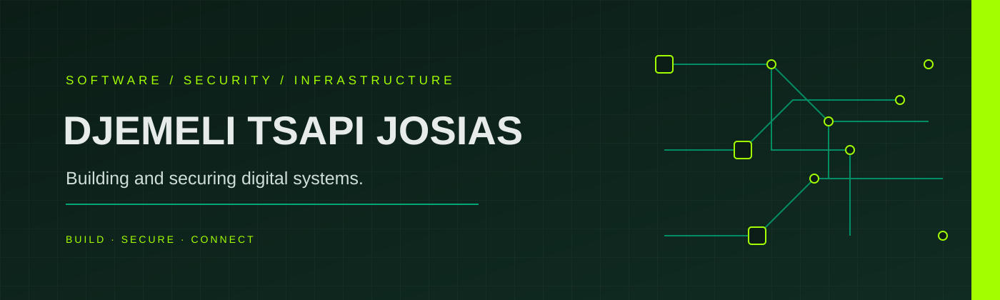

  
  <a href="https://www.linkedin.com/in/djemeli-tsapi-josias">LinkedIn</a> ·
  <a href="https://djemeli-tsapi-josias.vercel.app/">Portfolio</a> ·
  <a href="mailto:djemelitsapijosias@gmail.com">Email</a>

---

> Most software gets built fast. Security is often considered later. **I believe both should be designed together.**

I'm **Djemeli Tsapi**, an IT engineer from Cameroon working at the intersection of **software engineering, cybersecurity and network infrastructure**.

My background combines an HND in Computer Software Engineering with engineering-level training as an *Ingénieur de Travaux Informatiques*, specialized in **Quality and Security of Computer Systems and Networks (QSIR)** at IUT Fotso Victor de Bandjoun.

I build and secure digital systems across three connected layers.

## 01 / BUILD — Software Engineering

I design and develop applications and backend systems, with attention to functionality, maintainability and software quality.

- Full-stack web applications
- REST APIs and backend systems
- React.js, Express.js, PHP and Python/FastAPI
- PostgreSQL and MySQL
- Database design, software quality and testing

## 02 / SECURE — Cybersecurity

I work on understanding weaknesses, assessing technical risks and improving the security of applications, systems and networks.

- Security assessments and technical reviews
- Web application and network security
- Secure system design
- Linux and Kali environments
- Cryptography fundamentals
- Vulnerability research, analysis and technical recommendations

## 03 / CONNECT — Network Infrastructure

I work with the infrastructure that connects systems, services and users.

- Network architecture, deployment and administration
- Cisco and MikroTik environments
- Routers, switches and servers
- Linux systems
- High-availability architecture and redundancy
- Network troubleshooting and infrastructure security

---

# SELECTED PROJECTS

My projects span application development, cybersecurity, connected systems and infrastructure design.

### SHIELD — Secure Official-Document Verification

A collaborative final-year project: a web-based solution for managing, digitally signing and publishing official communications, with cryptographic verification and QR codes.

The project brings together full-stack development, authentication, digital signatures and document-integrity verification.

**Repository:** [SOFTWARE-ING/PFE](https://github.com/SOFTWARE-ING/PFE)

**Selected contributions:**

- [Project structure, documentation and 2FA — PR #13](https://github.com/SOFTWARE-ING/PFE/pull/13)
- [Frontend contribution — PR #11](https://github.com/SOFTWARE-ING/PFE/pull/11)
- [Backend configuration and routing — PR #12](https://github.com/SOFTWARE-ING/PFE/pull/12)
- [Mobile integration — PR #16](https://github.com/SOFTWARE-ING/PFE/pull/16)

*SHIELD is collaborative work. These links identify contributions within the shared project repository.*

### University Management System

A multi-part academic management application. My GitHub account currently contains the frontend repository.

**Repository:** [ums-frontend](https://github.com/djemelitsapijosias/ums-frontend)

### Other Engineering Projects

Additional academic, collaborative and independent work includes:

- Birth-certificate registration and issuance platform
- IoT-based anti-theft system
- High-availability architecture and redundancy projects
- University and business management systems
- Technology hackathon projects

Project documentation and public source-code links are being organized as the portfolio is rebuilt.

---

# EXPERIENCE & TECHNICAL PRACTICE

My experience includes software engineering work at **SIGERIS SARL**, network and IT work at **ISSAB University**, and independent projects involving web development, IT support, cybersecurity recommendations and network infrastructure.

I also contribute to technical learning and project reviews through collaborative work with students and developers, sharing practical guidance on applications, networks, Linux environments and security.

---

# TECHNOLOGIES & TOOLS

**Development**

`JavaScript` `PHP` `Python` `React.js` `Express.js` `FastAPI`

**Databases**

`PostgreSQL` `MySQL` `SQL`

**Cybersecurity & Systems**

`Linux` `Kali Linux` `Nmap` `Wireshark` `Burp Suite`

**Networking**

`Cisco` `MikroTik` `Routing` `Switching` `Network Infrastructure`

**Development Workflow**

`Git` `GitHub` `VS Code` `Draw.io`

---

# CURRENT DIRECTION

I'm interested in opportunities where I can contribute across software engineering, cybersecurity or network/infrastructure engineering while deepening my experience in security operations and, over time, SOC environments.

I'm particularly interested in:

- Secure software architecture
- Web application and network security
- Infrastructure resilience and high availability
- Vulnerability analysis and security research
- Distributed systems and network services
- Security operations and SOC environments

---

# LET'S CONNECT

If you're building a web application, improving the security of an existing system, or designing and deploying reliable network infrastructure, let's talk.

- **Email:** [djemelitsapijosias@gmail.com](mailto:djemelitsapijosias@gmail.com)
- **LinkedIn:** [Djemeli Tsapi Josias](https://www.linkedin.com/in/djemeli-tsapi-josias)
- **Portfolio:** [djemeli-tsapi-josias.vercel.app](https://djemeli-tsapi-josias.vercel.app)
- **GitHub:** [github.com/djemelitsapijosias](https://github.com/djemelitsapijosias)

  BUILD · SECURE · CONNECT

